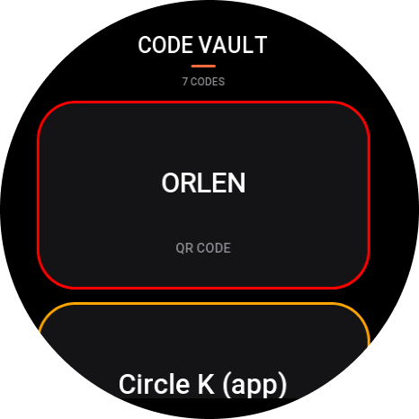
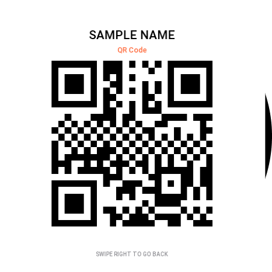
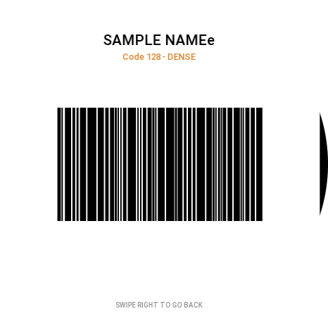
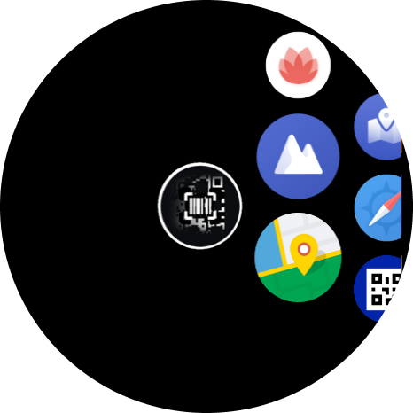
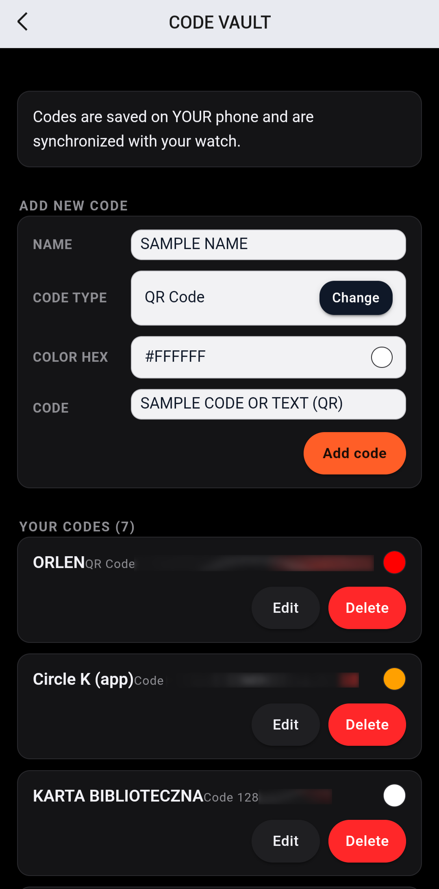

<p align="center">
  
</p>

<h1 align="center">Code Vault</h1>

<p align="center">
  <strong>Your QR, barcode & 2D code wallet — on your wrist.</strong><br>
  Built for Amazfit Active 2 Round · Zepp OS 5
</p>

<p align="center">
  
  
  
  
  
</p>

<p align="center">
  <sub>🇵🇱 <a href="README.pl.md">Polska wersja README</a></sub>
</p>

> [!WARNING]
> **Device support:** Code Vault was built and tuned specifically for the **Amazfit Active 2 Round (466×466)**. It has **not been tested on other watches**. Other Zepp OS devices may work, but layouts, borders, and gestures are not guaranteed.

> [!NOTE]
> **Vibe-coded from start to finish.** The entire application layer — UI, sync logic, code renderer, scripts, and tests — was built iteratively in a vibe-coding workflow with AI assistance. This is not corporate, reviewed production code. It was tested where possible, but it has not undergone a security audit or testing across multiple watch models.

---

## ✨ What is Code Vault?

Code Vault is a tiny **offline code wallet** for your wrist.

You add QR codes, barcodes, and 2D codes in the **Zepp App on your phone**. They are synced to the watch, stored locally, and rendered on demand — no internet connection required when you need to show a code.

It is **not a scanner**. The watch only displays codes; it does not read them.

| | |
|---|---|
| 📱 Phone side | Add, edit, delete, validate, and color-code entries in Zepp App |
| ⌚ Watch side | Scrollable list, native QR page, custom canvas renderer |
| 🔌 Sync | Zepp Settings Storage → app-side service → watch cache |
| 📴 Offline | Codes render locally on the watch |
| 🎨 Colors | Per-code HEX color, default `#FFFFFF` |
| 🧾 Formats | 51 types: 13 × 2D, 38 × 1D |
| 🚫 Network | No requests, no analytics, no telemetry |

---

## ⚡ How it works in 30 seconds

1. 📝 **Add a code** in Zepp App → Device → Apps → Code Vault.
2. 🔄 **App-side service** reads the saved list and pushes it to the watch.
3. 💾 **The watch caches** the list in `localStorage`.
4. 📺 **The watch renders** the selected code locally — native `QRCODE` for QR, canvas for everything else.
5. 📷 **Show the screen** to a scanner. That's it.

```text
Phone (Zepp App)                   Watch (Zepp OS)
┌──────────────────┐              ┌──────────────────┐
│ Settings App     │              │ Home list        │
│ "codes" storage  │──app-side──▶ │ localStorage     │
└──────────────────┘              │ QR / canvas      │
                                  └──────────────────┘
```

---

## 📸 Screenshots

<p align="center">
  <em>Home screen: large cards, 3 px color borders, roughly 1.5 cards visible.</em>
</p>

<table>
  <tr>
    <td align="center" width="33%">
      <br>
      <sub><strong>QR Code</strong><br>Native <code>QRCODE</code> widget</sub>
    </td>
    <td align="center" width="33%">
      <br>
      <sub><strong>Code 128</strong><br>Custom canvas renderer + <code>DENSE</code> warning</sub>
    </td>
    <td align="center" width="33%">
      <br>
      <sub><strong>App list</strong><br>Code Vault on the watch</sub>
    </td>
  </tr>
</table>

<p align="center">
  <br>
  <sub><strong>Settings App</strong> — add/edit codes, choose from 51 types, set a HEX color, validate content.</sub>
</p>

> Screenshots show demo data and the real UI. The phone screenshot comes from the Zepp App; the watch screenshots come from an Amazfit Active 2 Round.

---

## 🚀 Quick start

### Requirements

- 🟢 Node.js 18+
- 📦 npm
- ⚙️ [Zeus CLI](https://docs.zepp.com/)
- 👤 A Zepp account (`zeus login`)
- 📱 Zepp App with developer mode enabled
- ⌚ Amazfit Active 2 Round

### Install

```bash
git clone https://github.com/seythegamer/CodeVault-zeppos.git
cd CodeVault-zeppos
npm install
npx zeus login
```

`npm install` runs `scripts/patch-etiket.mjs`, which prepares the `etiket` library for QuickJS (including removing its `BigInt` dependency). If the patch does not run:

```bash
node scripts/patch-etiket.mjs
```

### Test

```bash
npm test
```

### Preview on the watch

```bash
npm run preview -- -t "Amazfit Active 2 (Round)"
```

Or directly:

```bash
npx zeus preview -t "Amazfit Active 2 (Round)"
```

Scan the QR code in Zepp App and install the app. Preview QR codes expire after a few days.

### Build

```bash
npm run build
```

The resulting `.zab` package appears in `dist/` (gitignored).

---

## 🧩 Features

- **51 code formats** — 13 × 2D and 38 × 1D.
- **One smooth `SCROLL_LIST`** on the home screen, no pagination.
- **Big, readable cards** — about 1.5 cards visible at once.
- **Per-code color** — 3 px colored border and a matching dot in Settings.
- **Native QR rendering** — plain QR uses the `QRCODE` widget.
- **Custom canvas rendering** — all other formats are drawn locally.
- **Auto-rotation for 1D** — picks horizontal or vertical orientation based on scale.
- **`DENSE` warning** — flags codes that may be hard to scan.
- **Offline cache** — the last synced list is always available.
- **Gesture-only navigation** — swipe right to go back; no on-screen BACK button.
- **Tap targets** — only the name and type are clickable, not the whole card.
- **Input validation** — content length, color format, and type-specific checks.
- **Demo data** — `Sample QR` and `Sample Code 128` on first launch.

---

## 🧠 How on earth does this work?

The watch does not run a browser, a native barcode library, or a server request. Everything is **JavaScript on QuickJS**, drawing pixels on a small canvas.

Here is the full pipeline.

### 1. Phone side — Settings App

`setting/index.js` is a Zepp App settings page, not a separate phone app. It provides:

- name, type, color, and content fields,
- a 51-item type picker,
- add, edit, and delete with confirmation,
- validation,
- HEX color normalization,
- storage under the `codes` key.

Legacy codes without a color are normalized to `#FFFFFF`.

### 2. Phone side — app-side service

`app-side/index.js` is a ZML `BaseSideService`.

- `GET_CODES` returns the current list.
- `onSettingsChange` listens for changes to `codes` and pushes a `CODES` event to the watch.
- It uses `settingsLib`, so no external server is involved.

### 3. Watch side — cache and sync

`page/home/index.page.js`:

- reads the cached list from `localStorage` first,
- requests `GET_CODES` for fresh data,
- normalizes codes and writes the cache,
- re-renders only when the data actually changes.

The code screens also read the cache first and only request data when the target code is missing.

### 4. Encoding pipeline

`shared/encode.js` selects the right encoder from `etiket`:

- `encodeQR`, `encodeMicroQR`, `encodeRMQR`,
- Data Matrix and GS1 Data Matrix,
- PDF417 and MicroPDF417,
- Aztec and Aztec Rune,
- DotCode, Han Xin, Codablock F, Code 16K,
- `encodeBars` for all 1D formats.

The output is either a **2D matrix** or a **list of 1D bar widths**.

### 5. Layout and painting

`shared/draw.js` converts the encoded data into drawable rectangles:

- calculates the best scale,
- adds quiet zones,
- centers the symbol on screen,
- for 1D codes, tries both horizontal and rotated layouts and keeps the larger one.

`utils/render.js` paints:

- a white background,
- black rectangles for bars and modules,
- circles for dot-based codes such as DotCode.

QR codes skip this path and use the native `QRCODE` widget for maximum reliability.

### 6. Colors and the card border hack

Each code stores a color like `#FF6B3D`. The Settings app shows it as a dot on the card.

`SCROLL_LIST` has no native border property, so the watch card uses a workaround:

1. `item_bg_color` is set to the user's color.
2. A dark, rounded `assets/gt.r/card-inner.png` is drawn on top, inset by 3 px.
3. The remaining visible ring becomes the colored border.

It works, but it depends on the firmware's draw order — this is a hack, not a documented API.

### 7. QuickJS and the `etiket` patch

Zepp OS uses QuickJS, which does not provide `BigInt` in this environment. Some `etiket` encoders rely on `BigInt` for large-number math.

`scripts/patch-etiket.mjs` rewrites those parts after `npm install`:

- replaces `BigInt` arithmetic with regular number/string math,
- patches PDF417 base-900 conversion,
- patches GS1 DataBar calculations.

This is why `npm install` takes a moment — and why updating `etiket` can break the patch.

### 8. Stability workarounds

The app also includes pragmatic safeguards against race conditions and early rendering:

- cache-first reads on code pages,
- one delayed render (60–70 ms),
- no redraw when the code is unchanged,
- no cache writes from code pages,
- widget cleanup on destroy,
- short navigation guard on the home screen,
- `onPause` / `onResume` awareness.

These reduce crashes but do not fix the underlying firmware issue.

---

## 📦 Supported formats

<details>
<summary><strong>2D — 13 types</strong></summary>

- QR Code
- Micro QR
- rMQR
- Data Matrix
- GS1 Data Matrix
- PDF417
- MicroPDF417
- Aztec Code
- Aztec Rune
- DotCode
- Han Xin
- Codablock F
- Code 16K

</details>

<details>
<summary><strong>1D — 38 types</strong></summary>

- Code 128
- GS1-128
- EAN-13
- EAN-8
- UPC-A
- UPC-E
- EAN-2 (add-on)
- EAN-5 (add-on)
- Code 39
- Code 39 Extended
- Code 93
- Code 93 Extended
- ITF (Interleaved 2 of 5)
- ITF-14
- GS1 EAN-14
- SSCC-18
- Codabar
- MSI Plessey
- Code 11
- Plessey
- Pharmacode
- ISBN
- ISSN
- ISMN
- Code 32 (Italian Pharmacode)
- PZN
- PZN8
- Identcode (DP)
- Leitcode (DP)
- GS1 DataBar Omnidirectional
- GS1 DataBar Limited
- GS1 DataBar Expanded
- GS1 DataBar Truncated
- Industrial 2 of 5
- IATA 2 of 5
- Matrix 2 of 5
- COOP 2 of 5
- Datalogic 2 of 5

</details>

---

## 🧰 Tech stack & libraries

| Layer | Technology | What it does |
|---|---|---|
| Runtime | Zepp OS 5 / QuickJS | Runs the watch app |
| UI | `@zos/ui` | Widgets: `SCROLL_LIST`, `CANVAS`, `QRCODE`, `TEXT` |
| Navigation | `@zos/router` | Opens code pages and goes back |
| Gestures | `@zos/interaction` | Swipe-right back gesture |
| Storage | `@zos/storage` | Watch-side `localStorage` cache |
| Device info | `@zos/device` | Screen size |
| Timers | `@zos/timer` | Delayed, single render |
| Sync | `@zeppos/zml` | `BasePage`, `BaseSideService`, settings bridge |
| Encoding | [`etiket`](https://www.npmjs.com/package/etiket) | QR, 1D, and 2D encoders |
| Phone UI | Zepp App Settings API | `View`, `Text`, `TextInput`, `Button` |
| Tooling | Zeus CLI, Node.js, npm | Build, preview, tests |
| Tests | Custom Node runner | 51-type encode/layout check |
| Types | `jsconfig.json`, `global.d.ts` | Editor hints only; no TypeScript runtime |

---

## 🗂️ Repository structure

```text
.
├── app.js                       # app entry point
├── app.json                     # Zepp OS config, pages, permissions
├── page/
│   ├── home/index.page.js       # code list, SCROLL_LIST, colors
│   ├── qr/index.page.js         # native QRCODE widget
│   └── view/index.page.js       # canvas for 1D and other 2D codes
├── setting/index.js             # Settings App inside Zepp App
├── app-side/index.js            # app-side service, GET_CODES and push
├── shared/
│   ├── catalog.js               # definitions for all 51 code types
│   ├── encode.js                # encoding through etiket
│   ├── draw.js                  # matrices, bars, scale, rotation
│   ├── defaults.js              # default codes, color validation
│   └── polyfills.js             # QuickJS polyfills
├── utils/
│   ├── cache.js                 # code cache in localStorage
│   └── render.js                # canvas layout and painting
├── assets/
│   ├── gt.r/                    # icons and card-inner.png
│   └── gt.s/
├── images/                      # README screenshots
├── scripts/patch-etiket.mjs     # patches etiket for QuickJS
├── test/run.mjs                 # encoding and layout tests
└── dist/                        # build output (gitignored)
```

---

## 🧪 Tests

```bash
npm test
```

Coverage:

- 51/51 code types pass encoding,
- matrix and bar layout is checked,
- minimum scale and quiet zones are checked.

Not covered:

- ❌ not every code-type has been tested with a scanner,
- ❌ CI,
- ❌ visual regression tests,
- ❌ firmware regression tests.

---

## 🛠️ Where we took shortcuts

This is a conscious list of trade-offs, not an attempt to hide problems.

1. **Vibe-coding instead of a traditional process.**  
   The code was built in a dialogue with AI, iteratively. There is no code review history, ADRs, or team process here. Tests and manual checks on available hardware were the only quality gate.

2. **`etiket` is patched inside `node_modules`.**  
   `scripts/patch-etiket.mjs` modifies files after `npm install`. It is fast, but fragile: updating `etiket` may break the patch. The proper solution is to pin an exact version and vendor the patched encoders.

3. **No native border in `SCROLL_LIST`.**  
   The colored border is implemented with `item_bg_color` plus an inner PNG. It is a hack and may behave differently on other firmware versions.

4. **Stability through delays and flags.**  
   Delayed rendering, cache-first reads, and navigation guards reduce the risk of crashes, but they do not remove the underlying firmware issue.

5. **QR is native; everything else is custom-rendered.**  
   Only plain QR uses `QRCODE`. The other 50 formats use a custom canvas layout — more control, but also more room for visual bugs.

6. **Tests do not scan codes.**  
   The tests confirm that the encoder and layout finish successfully. They do not confirm that every code can be read by a phone or scanner.

7. **No encryption.**  
   Codes are stored as plain text in Zepp App storage and in the watch's `localStorage`. This is not a password vault.

8. **Layout for one screen.**  
   The UI is tuned for a round 466×466 display. Other screen sizes may require adjustments.

9. **App identity is local.**  
   `appId: 20001` and `vender: "local"` are preview values. Publishing to the Zepp store requires replacing them with your own details.

10. **No CI and no license.**  
    The repository has no pipeline and no `LICENSE` file. Before publishing as open source, add both.

---

## 🔒 Security & privacy

- 🚫 No network requests.
- 🚫 No analytics, telemetry, or tracking SDK.
- 🚫 No network permissions in `app.json`.
- 💾 Codes stay on the phone and the watch.
- 🔐 No GitHub, Zepp/Amazfit, or Zeus credentials are stored in the repository.
- ⚠️ **Codes are not encrypted.** Do not store passwords, tokens, or other secrets in them.

---

## 🗺️ Roadmap

- [ ] Test on more firmware versions and watch models
- [ ] Verify all 51 formats with a physical scanner
- [ ] Add more screenshots and short demo clips
- [ ] Add CI running `npm test`
- [ ] Pin `etiket` and vendor the patch instead of modifying `node_modules`
- [ ] Add adaptive layout for other resolutions
- [ ] Add optional encryption
- [ ] Add a `LICENSE` file

---

## 📄 License

There is no `LICENSE` file. If you want to publish this as open source, add a license of your choice — for example, MIT.

---

## 🙏 Credits

- [Zepp OS Developers Documentation](https://docs.zepp.com/)
- [`etiket`](https://www.npmjs.com/package/etiket) for QR / 1D / 2D encoding
- The Zepp OS community
- AI as a vibe-coding partner

---

## ⚠️ Disclaimer

Hobby project, not affiliated with Zepp Health or Amazfit. Built for **Amazfit Active 2 Round** only and not tested on other watches. Use at your own risk. Codes may not work with every scanner — test the specific format and device before relying on it in practice.
